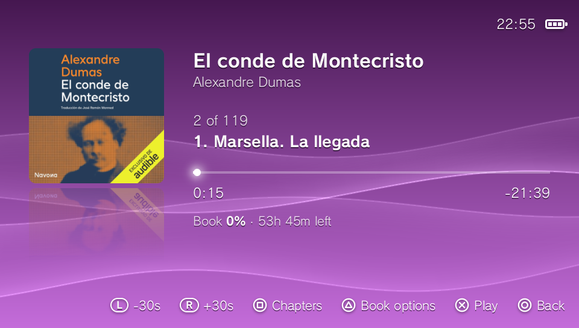
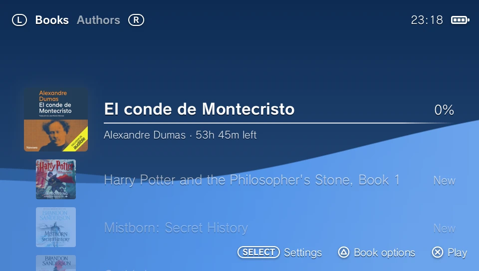
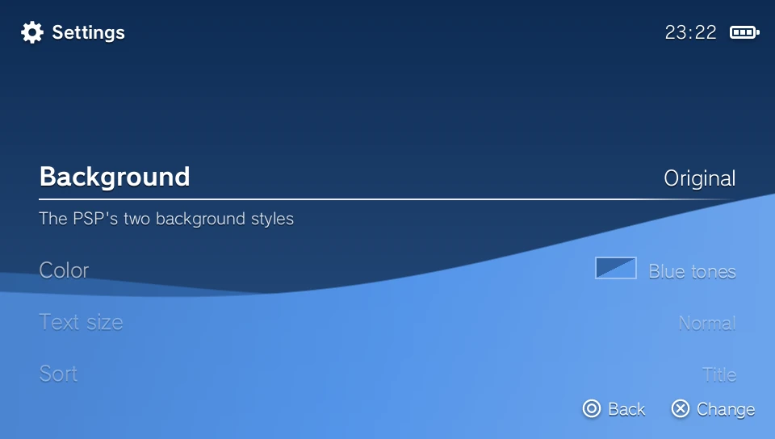
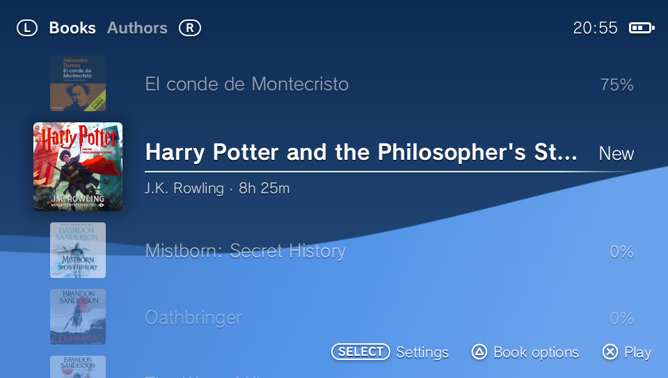
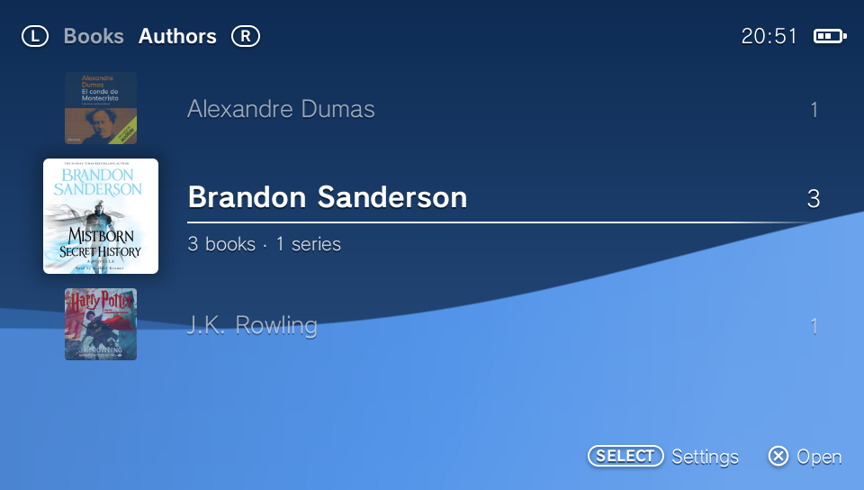
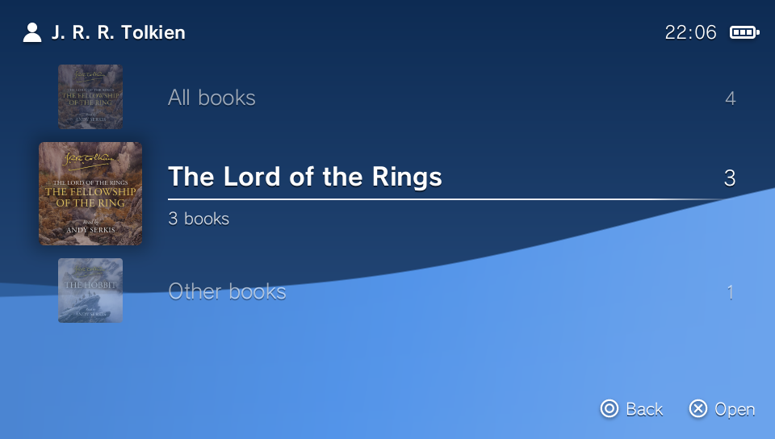
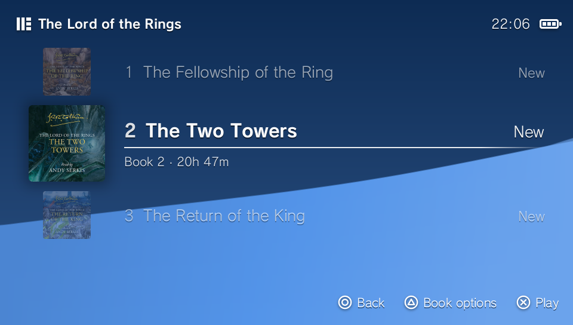
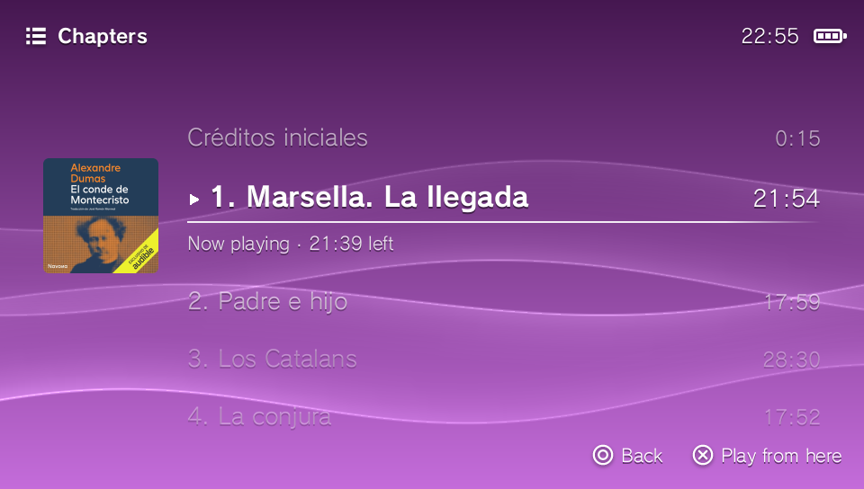
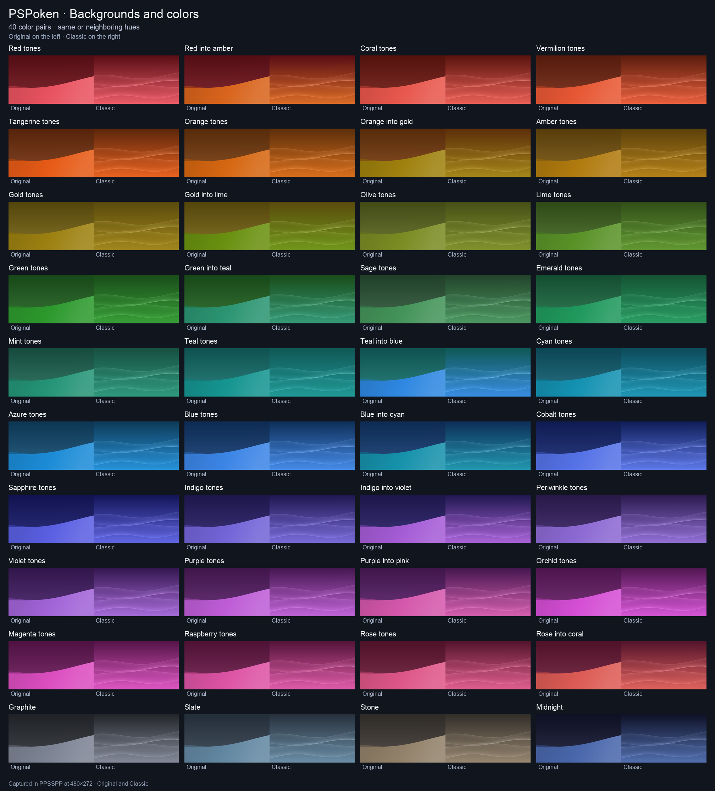

# PSPoken



<sub><em>Captured on PS Vita at its native 960×544 resolution.</em></sub>

An audiobook player for the PSP and the PS Vita. It plays DRM-free `.m4b` audiobooks with their chapters, covers and details, and remembers your place in every book.

> **0.8.0-alpha — first community test release.** I've tested it on a small set of devices; your feedback will help establish compatibility. The app is closed source and free to use. The optional PSP kernel module is open source, in [`kernel/`](kernel/). See [Source code](#source-code).

**[Downloads](https://github.com/hm4rkus/PSPoken-release/releases) · [Installation](#installing) · [Controls](#controls) · [Optional PSP features](#optional-psp-kernel-module)**

## Interface in motion

Browsing authors and their books:



Previewing backgrounds and colors:



## Features

- **Pick up where you stopped** in every book.
- **Browse by cover, author or series**, with sorting and progress at a glance.
- **Chapters and time remaining**, with adjustable skips and scrubbing.
- **Keep listening while you browse** your library.
- **Pocket listening** with locked buttons and lower PSP CPU clocks while dark.
- **Your look:** two backgrounds, 40 color pairs and three text sizes.
- **A familiar feel:** system fonts, console button symbols and quiet interface sounds.

### PSP extras with the optional kernel module

The included `pspoken_kernel.prx` adds:

- **Hardware dimming and screen-off** while the book keeps playing.
- **Go slider control:** close to lock and switch off the screen; open to wake.
- **Go Bluetooth controls:** play, pause and skip, even while locked or dark.
- **Live volume display** as you adjust the volume.

[See what changes without the module and how to choose.](#optional-psp-kernel-module)

### Native PS Vita

- **A native 960×544 interface** with the Vita’s system fonts.
- **Screen-off listening:** hold SELECT to lock; automatic dimming and screen-off are also available.
- **Bluetooth controls while locked or dark**, without an extra plugin.
- **AAC-LC and full-quality HE-AAC v1**, including books larger than 2 GiB.

## Images

| Library | Authors |
| --- | --- |
|  |  |

| An author's series | A series’ books |
| --- | --- |
|  |  |



### Backgrounds and colors

Both background styles in all 40 color pairs. Open the image to see every combination.

[](assets/screenshots/backgrounds.png)


## Optional PSP kernel module

**Listen with the backlight powered off, control playback from Bluetooth headphones on the Go, and see the volume while you adjust it.** The included `pspoken_kernel.prx` enables these PSP features, which need access to system functions outside a normal app.

**The app works without it.** You choose whether to load kernel code:

| Feature | With the module | Without the module |
| --- | --- | --- |
| Display and backlight | Hardware dimming and power-off, triggered by HOLD or the playback idle timer | Visual dimming only; the app cannot switch off the display or backlight |
| PSP Go slider | Closing locks the app’s buttons; opening wakes it | The app cannot detect the slider; the console’s own close action still applies |
| PSP Go Bluetooth media buttons | Play / pause and skip, including while locked | Bluetooth audio still works; media buttons do not control PSPoken |
| Volume display | An in-app bar follows volume changes | Volume buttons still work; the app does not show a volume bar |

Playback, the library, progress saving, HOLD button locking, and CPU clock reduction while dark work without the module. Sony’s wired-remote support also works independently of it (hardware testing is still pending).

To enable these extras, leave `pspoken_kernel.prx` beside `EBOOT.PBP`. To run without the module, omit that file, or remove it while PSPoken is closed. If it is missing or cannot load, the app continues without those extras.

The module loads only while PSPoken runs; it does not need a system plugin entry. It can control the display and brightness and read system buttons, volume and Bluetooth media events. It does not write to storage or flash, patch the system, use the network, or start its own threads. Because it runs in kernel mode, a bug can freeze the console.

Its source is published in [`kernel/`](kernel/), with [every call and the rebuild instructions documented](kernel/README.md). You can rebuild it and compare its hash with the shipped file. That verifies this module; the rest of the app remains closed source.

## Requirements

Custom firmware must already be installed. PSPoken does not run on an unmodified console.

**PSP**
- Any model: PSP-1000, 2000, 3000, Go or Street.
- System software 6.60 or 6.61 with custom firmware. PSPoken is made and tested with **ARK-4**. Other custom firmware for 6.60/6.61 (PRO, ME) should work, but hasn't been tested.
- Tested on the PSP Go, PSP-1000 and PSP-3000.

**PS Vita**
- A PS Vita with HENkaku (installed by any of its usual methods), and VitaShell to install the VPK.
- This is a **native Vita app**: install the VPK directly, without Adrenaline.
- Tested on the PS Vita 2000. The PS Vita 1000 and the PS TV haven't been tested yet.

## Your audiobooks

- **`.m4b` files, DRM-free.** Purchased books with DRM (Audible's `.aa` / `.aax`, for example) won't play.
- **AAC-LC audio** plays at full quality on every model.
- **HE-AAC v1 audio** plays at full quality on the PSP Go, the PSP-3000 and the PS Vita. The PSP-1000 plays a simpler version of it, with a duller sound. The PSP-2000 and Street haven't been tested.
- **HE-AAC v2** plays in mono. MP3, Opus, FLAC, ALAC and xHE-AAC are not supported.
- **For a PSP-1000,** encode as AAC-LC: it plays at full quality on every model.
- **Chapters** are read from the book (QuickTime chapters or Nero chapters). A book without chapters plays as one long chapter.
- **Covers** must be embedded JPEG images. A book with a PNG cover, or none, gets a generated cover with its title and author.

To convert audiobooks from other formats, use a tool such as [m4b-tool](https://github.com/sandreas/m4b-tool) or [ffmpeg](https://ffmpeg.org/).

## Installing

Choose the **PSP ZIP** for a PSP or the **Vita VPK** for a PS Vita.

### PSP

1. Download `PSPoken-<version>-PSP.zip` from [Releases](../../releases) and unzip it.
2. Copy the `PSPoken` folder into `PSP/GAME/` on the Memory Stick (on the PSP Go, its internal storage or a Memory Stick Micro). It must end up as `PSP/GAME/PSPoken/EBOOT.PBP`. Keep `pspoken_kernel.prx` beside it to enable the [optional PSP features](#optional-psp-kernel-module), or omit that file to run without them.
3. Make a folder called `AUDIOBOOKS` at the root of the Memory Stick (or the Go's internal storage) and copy your `.m4b` files into it. Folders inside it are fine.
4. Start **PSPoken** from Game > Memory Stick (or System Storage on the Go). The first start reads every book and makes its covers, which takes a moment. Later starts are quick.

The card or internal storage should look like this:

```text
AUDIOBOOKS/
  Example Author/
    Example Book.m4b
PSP/
  GAME/
    PSPoken/
      EBOOT.PBP
      pspoken_kernel.prx
```

On the Go, books on both internal storage and the M2 card appear in one library.

**Go slider:** to keep listening with the slider closed, set **Settings → System Settings → [Display Panel Close Options](https://manuals.playstation.net/document/en/psp/current/settings/panelclose.html)** to **Standard**, rather than **Enter Sleep Mode**.

**Updating:** copy the new `PSPoken` folder over the old one. Your settings, progress and covers are kept.

### PS Vita

1. Download `PSPoken-<version>-Vita.vpk` from [Releases](../../releases), copy it to the Vita, and install it with VitaShell.
2. Make a folder called `AUDIOBOOKS` and copy your `.m4b` files into it. It can be at the root of `ux0:` (the memory card, or an SD2Vita mounted as `ux0:`), `uma0:` (an SD2Vita mounted beside the memory card) or `imc0:` (the PS Vita 2000's internal storage).
3. Start **PSPoken** from the home screen.

For example, a book can be at `ux0:/AUDIOBOOKS/Example Author/Example Book.m4b`. You do not need to put books inside the app’s install folder. The first launch prepares the library and covers.

**Updating:** install the new VPK over the old one. Your settings and progress are kept (they're in `ux0:data/PSPoken/`).

## Controls

If your console is set to confirm with ○, PSPoken follows: × and ○ swap.

**Library**

| Button | Does |
| --- | --- |
| L / R | Books and Authors tabs |
| × | Play the selected book (on the Authors tab: that author's books) |
| △ | Book menu: play, restart, mark finished / unfinished, go to author / series, Information (options depend on the book) |
| START | Back to the book playing |
| SELECT | Settings |

**Player**

| Button | Does |
| --- | --- |
| × | Play / pause |
| L / R (tap) | Skip back / forward (30 s, or the Skip interval in Settings) |
| L / R (hold) | Scrub back / forward, landing where you let go |
| ◀ / ▶ | Previous / next chapter (◀ goes to the start of the chapter first) |
| □ | Chapter list |
| △ | The book's options |
| ○ | Back to the library (the book keeps playing) |
| Analog stick | Scrub, faster the further it's pushed (can be turned off in Settings) |

**Volume:** the console’s own volume buttons.

**Headphone controls:** on the PSP Go and PS Vita, compatible Bluetooth headphones can use one tap for play / pause, two to skip forward, three to skip back. The gesture depends on your headphones; PSPoken responds to their play / pause, next and previous commands. Sony’s wired remote has separate play / pause and skip buttons. Skips use your selected interval.

**Book information:** use △ → Information; scroll long details with the d-pad or analog stick.

**Screen off:**
- **PSP, with the optional kernel module:** the HOLD switch, or closing the PSP Go's slider. Buttons are locked and the book plays on. Release HOLD or open the slider to wake it.
- **PS Vita:** hold SELECT for a second to turn the screen off and lock the buttons. Use the power button to wake it through the system's lock screen. A short press of SELECT opens Settings while the screen is on. The PS button is locked while the screen is off.

On the Vita, pressing PS to return to LiveArea **pauses playback and saves your place**. Playback behind LiveArea is not supported.

## Settings

SELECT in the library opens Settings:
- Background style: Original or Classic.
- Color pair.
- Skip interval: 10, 15, 30 or 60 s.
- Screen off after: 10 s, 30 s, 1 min, 5 min or Never. It only applies while a book plays.
- Text size: Small, Normal or Large.
- Sort: Recently played, Title or Author.
- Interface sounds: on or off.
- The analog stick: on or off, for a stick that drifts.
- Battery percentage: show the charge beside the battery icon; off by default.

## Your data

- **PSP:** in the app's folder, `PSP/GAME/PSPoken/`: your settings (`settings.txt`), your place in each book (`progress.txt`), the library's cache (`library.cache`) and the covers (`covers/`). Deleting `progress.txt` starts every book over.
- **PS Vita:** the same files, in `ux0:data/PSPoken/`.

Playback works offline: no account, downloads or streaming.

## Alpha limitations

- Tested by me on the PSP Go, PSP-1000, PSP-3000 and Vita-2000. PSP-2000, Street, Vita-1000, PS TV and other custom firmware setups need community testing.
- Sony’s wired remote has not been tested. Bluetooth media controls are available on the PSP Go and PS Vita; other PSP models use Sony’s wired remote.
- The optional battery percentage reports the system’s estimate; on the PSP Go it can change in large steps.

## Problems and ideas

- Open an issue at [Issues](../../issues) and choose **Bug** or **Idea**. The form asks for what helps: your model, firmware, PSPoken's version and what happened.
- **Attach PSPoken’s log** if you can: `pspoken_log.txt` in the app's folder on the PSP, or in `ux0:data/PSPoken/` on the PS Vita. It lists your books' file names, so look it over before you post it.

## Source code

**The app is closed source.** The builds in [Releases](../../releases) are free to use and to share unchanged, under [`LICENSE.md`](LICENSE.md).

**The kernel module is open source.**
- **What's here:** its whole source, in [`kernel/`](kernel/), with every call it offers explained. My code is under the MIT license. The built module also contains the custom firmware's systemctrl import stubs (GPL-3.0), so it's distributed under the GPL-3.0, its source here.
- **Checking it yourself:** every release's `pspoken_kernel.prx` is built from that source by this repository's Actions, and its SHA-256 is in the release's `SHA256SUMS.txt`. [`kernel/README.md`](kernel/README.md) says how to build it and compare.

The PS Vita version has no kernel module.

## Credits and notices

PSPoken uses intraFont by BenHur (CC BY-SA 3.0) and libjpeg-turbo, which is based in part on the work of the Independent JPEG Group. The full notices are in [`THIRD_PARTY_NOTICES.md`](THIRD_PARTY_NOTICES.md).

PSPoken is unofficial homebrew. It is not made, licensed or endorsed by Sony. "PlayStation", "PSP" and "PS Vita" are trademarks of Sony Interactive Entertainment.
